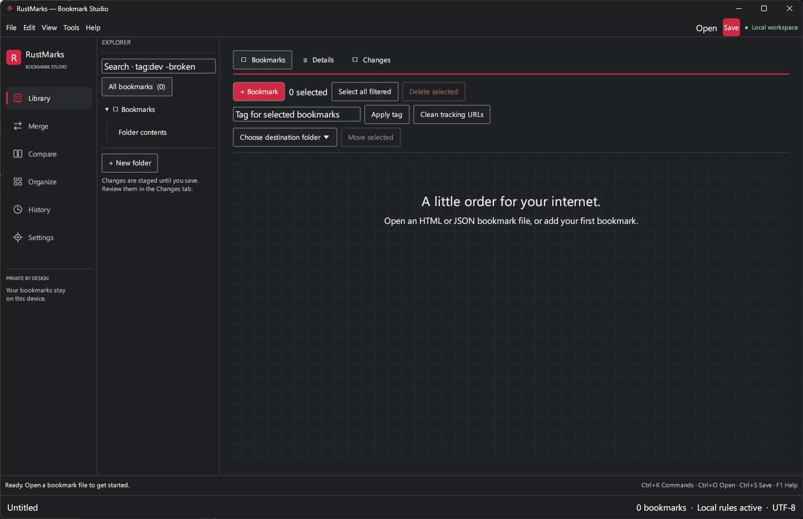
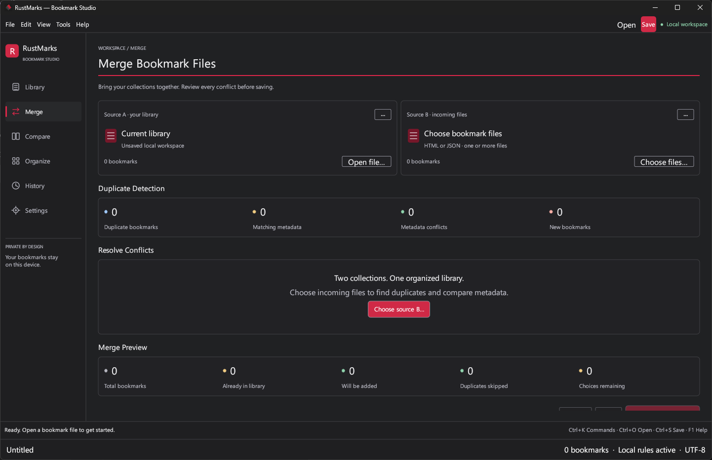
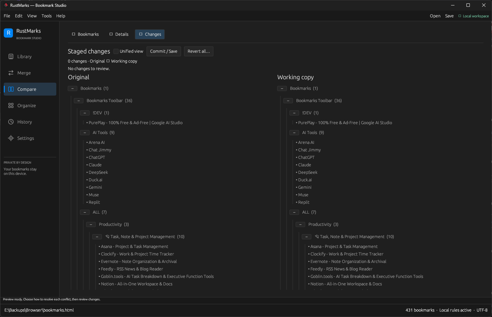
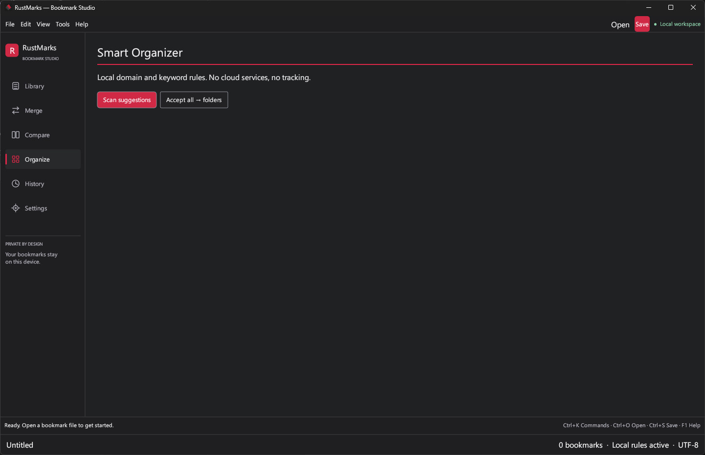
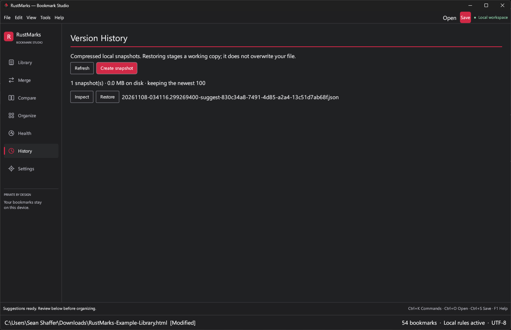
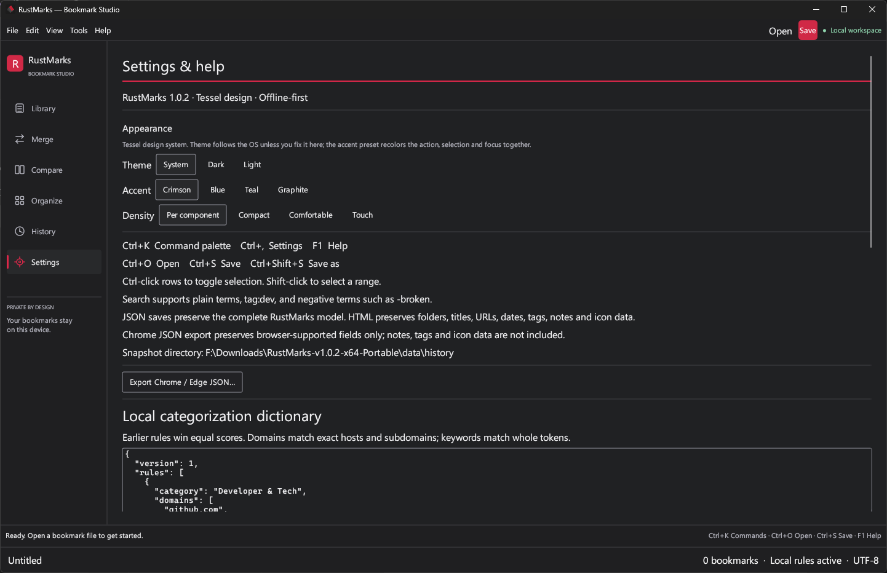

# RustMarks

An offline-first, native **Rust / egui desktop bookmark studio**, designed for Windows with a reference-inspired **charcoal** workspace. No browser runtime, account, telemetry, or backend.

## Screenshots

Real captures from a Windows machine running the v1.0.2 portable build — the Tessel design on a real desktop.

**Library** — folder tree, inline-editable grid, search expressions (first launch, before a file is opened; the grid fills the same canvas):



**Merge** — duplicate detection and per-conflict resolution before anything is written:



**Compare** — staged changes, original vs. working copy:



**Organize** — local, rule-based folder suggestions (no cloud, no tracking):



**History** — compressed local snapshots you can inspect and restore:



**Settings & help** — appearance (theme, accent, density), shortcuts, format notes, and the local categorization dictionary editor:



## Install on Windows

Download from the GitHub release page:

- `RustMarks-v<version>-x64-Setup.exe` — per-user installer (no admin rights, offline, no prerequisites).
- `RustMarks-v<version>-x64-Portable.zip` — unzip anywhere; all data stays in `data/` beside the exe (see Portable mode).
- `SHA256SUMS.txt` — checksums for both files. The binaries are not code-signed, so SmartScreen may warn.

## Build from source

Install the stable [Rust toolchain](https://rustup.rs/) and the **Desktop development with C++** workload from Visual Studio Build Tools (including the Windows SDK), then:

```powershell
cargo run --release
cargo build --release   # target/release/rustmarks.exe
```

Installers are built with `scripts/build-installers.ps1` (WiX 5). CI builds and tests on Windows and runs an install/uninstall smoke test on every packaging change. Building needs internet to fetch crates; the finished application operates offline.

Linux is also supported by eframe/rfd, but requires platform development libraries (on Debian/Ubuntu: `build-essential pkg-config libx11-dev libxi-dev libxcursor-dev libxrandr-dev libxinerama-dev libxkbcommon-dev libwayland-dev libgl1-mesa-dev libasound2-dev libudev-dev`) and a graphical session. Linux file dialogs use XDG portals.

## Tessel design

RustMarks follows the [Tessel design system](https://github.com/SeanShaffer88/TesselGUI): token colors on every surface, one crimson primary action per region, selection shown with a crimson marker rather than a flood of color, edges — not fills — building the structure, and a 24px grid motif in empty states. The theme follows the operating system's light/dark setting; Settings & help can fix Dark or Light, switch the accent preset (Crimson, Blue, Teal, Graphite), and set density (Per component, Compact, Comfortable, Touch). Appearance choices persist locally in `settings.json`. Labeled navigation opens **Library, Merge, Compare, Organize, Health, History and Settings** — Health runs a fully local scan for duplicate URLs, empty folders, missing titles, tracking parameters and malformed URLs, with one-click fixes that snapshot first. **Ctrl+K** opens the command palette, **Ctrl+,** opens Settings, and **F1** opens help. The full adoption notes, including the framework deviations, live in [docs/tessel-adoption.md](docs/tessel-adoption.md).

**Merge** follows the supplied reference: two source cards, duplicate-detection metrics, a bounded/virtualized conflict table with per-row dropdowns, preview metrics and **Review Changes**. Counts come from loaded documents, not mock records. File names / URLs truncate with full-value tooltips, and the page scrolls at smaller window sizes.

### Try the merge workflow

1. Open `examples/bookmarks.html` as the library (Source A).
2. Select **Merge**, then choose `examples/merge-incoming.html` as Source B.
3. The engine should report 5 existing bookmarks, 4 incoming, 3 duplicates, 2 metadata conflicts, 1 addition and 6 bookmarks in the candidate. These expectations are covered by a fixture regression test; they are not hardcoded in the GUI.
4. Choose **Keep source A**, **Prefer source B**, or **Combine metadata** for **every** conflict, or explicitly use **Apply to all N conflicts**. Decisions initially remain unselected.
5. Filtering does not hide unresolved conflicts from the review gate. The remaining-choice count always covers the entire preview.
6. **Review Changes** becomes available only when all decisions exist and the library still matches the preview. It takes a safety snapshot and stages the candidate in Compare. Save remains an explicit, separate disk operation.
7. **Refresh** reloads the same incoming paths against the current library and resets decisions. A failed refresh leaves the previous review and library unchanged. **Clear** discards only the preview, not library edits.

Source A's open action honors the unsaved-changes prompt. Multiple incoming files are supported. If the library changes after previewing, the preview is blocked until refreshed; a snapshot failure preserves both the working library and the ready review. Unsupported reference actions such as "keep newest" or "keep both" are deliberately not displayed. Matching metadata uses the engine's existing compared fields: title, tags, notes and favicon.

## First steps

1. **Open** an exported Netscape bookmark HTML file, Chrome/Edge bookmark JSON, or a RustMarks JSON document. Try `examples/bookmarks.html`.
2. Expand the **Explorer** and select a folder, or use **All bookmarks**. Search titles, URLs, tags and notes using expressions such as `tag:dev -broken`.
3. Edit cells directly. Click row numbers to select, Ctrl-click to toggle rows, or Shift-click to select a range. Apply tags, delete selections, or remove tracking parameters in bulk.
4. Use **Details** for longer notes, URL validation, and local favicon import/preview (PNG, JPEG, ICO or GIF, normalized to a 32px PNG). Folder names can be edited in the sidebar.
5. Open **Organize**, scan local suggestions, and accept individually or move all suggestions into category folders.
6. In **Merge**, choose one or more files. Resolve every conflict explicitly, then use **Review Changes** to stage the candidate, not write directly to disk.
7. Inspect **Changes** in side-by-side or unified mode, then **Save** to commit. Revert restores the last committed document after taking a safety snapshot.
8. Use **Version History** to inspect and restore older snapshots into the working copy; review and save to commit the restored state.

**Shortcuts:** Ctrl+O open · Ctrl+S save · Ctrl+Shift+S save as · Ctrl+Z / Ctrl+Y session undo/redo when not editing text. In a grid cell, Up/Down or Enter moves between rows and Tab/Shift+Tab moves between cells. Left/Right retains normal text cursor navigation.

The grid virtualizes visible rows and keeps stable cell IDs. The bulk **Move selected** action preserves bookmark identity and accepts any folder in the tree. Document undo is bounded to 50 checkpoints; rapid typing is grouped, and text fields retain their own undo while focused.

## Portable mode

Place an empty file named `portable.txt` next to `rustmarks.exe` and all history, dictionaries and window state go to `data/` beside it; nothing is written under `%APPDATA%`. The release portable zip includes the marker. Without it, data lives under `%APPDATA%\RustMarks` (`$XDG_DATA_HOME/RustMarks` on Linux). Existing per-user data is not migrated automatically.

## Command line

Every library operation is also available headless — run `rustmarks` with any argument and no window opens. `rustmarks help` lists the commands: `check` (count bookmarks and folders), `health` (the Health scan, with `--fix` to apply fixes after a snapshot, and `--json` output for scripts; exit code 1 while issues remain), `merge` (base + incoming files, `--prefer existing|incoming|combine` for conflicts, existing wins by default), `clean-urls`, `export-chrome` and `snapshot`. You can also drop a bookmark file (`.html`, `.htm`, `.json`) onto the window to open it, with the same unsaved-changes protection as **Ctrl+O**.

## Window state

Window size, position and maximized state are saved to `window.json` in the data directory and restored on launch. Positions are only sanity-checked (finite, within +/-32000); there is no per-monitor check, so if a monitor is removed the OS decides where an off-screen window lands. Delete the file to reset.

## Formats & data safety

- **RustMarks JSON** is the lossless working format: stable IDs, tree structure, notes, tags, timestamps, suggestions and favicon data are preserved.
- **Netscape HTML** imports nested folders and bookmark attributes. Export escapes text and preserves dates, tags, icons and notes (`DATA-NOTES`, a RustMarks extension, and legacy `<DD>` descriptions). Other browsers may ignore custom note/tag attributes. IDs are regenerated on HTML import.
- **Chrome/Edge JSON** imports browser `roots` trees and converts the Windows-epoch microsecond timestamps. Settings includes a separate browser-compatible JSON export; that format omits RustMarks-only metadata. Saving an imported Chrome JSON file prompts for a new working file and refuses the original source path, preserving the browser file. Working files are native JSON or Netscape HTML. Never edit a live browser profile file.
- Saves use a same-directory temporary file, flush it, then rename it over the target. The previous committed state and the working copy are snapshotted before save. The containing directory must be writable.
- Major operations take compressed JSON snapshots first and cancel if a snapshot fails. These are stored in `%APPDATA%\RustMarks\history\` (or `$XDG_DATA_HOME/RustMarks/history`, defaulting to `~/.local/share/RustMarks/history` on Linux).
- Imports are limited to 64 MiB, folder depth to 128 levels, and restored snapshots to 64 MiB decompressed. Native documents require a folder root, a supported version, and unique node IDs. Local image imports have compressed-size, dimension and allocation limits.
- Closing with unsaved changes prompts to save, discard with a safety snapshot, or cancel.
- History is local, not encrypted, and has no automatic retention limit. Snapshots include bookmark URLs and notes; manage disk space and permissions accordingly.
- Merge comparison removes common tracking keys (`utm_*`, `fbclid`, `gclid`, `msclkid`) from HTTP(S) URLs and canonicalizes their scheme/host through the URL parser. **Fragments, query order, duplicate keys and raw query encoding are retained** to avoid collapsing distinct routes or changing meaningful values. Cleanup leaves non-web/invalid URLs and recognized signed queries (`signature`, `sig`, `X-Amz-Signature`, `X-Goog-Signature`, `oauth_signature`) untouched. Arbitrary application-specific signatures cannot be identified automatically; inspect staged changes before saving. Stored URLs stay verbatim unless you explicitly run URL cleanup.
- Merge imports retain folder structure, including intentionally empty folders. Combining the same notes/tags repeatedly does not append duplicate complete note lines or tags.
- Open files are tracked by exact source bytes. Saving back to the opened path checks for external edits, deletion, or a retargeted source symlink and refuses to overwrite a changed source. Reopen or use a distinct **Save as** destination to resolve the conflict. This is an optimistic check immediately before publication, **not an OS-level lock** against a writer racing the final rename. Saving through an existing symlink updates its target without replacing the link. Imported browser JSON protection recognizes canonical path aliases, rather than only comparing path strings.

## Architecture

| Module | Responsibility |
| --- | --- |
| `models.rs` | Unified document, folders, bookmarks and tree operations |
| `parser.rs` | Netscape HTML, Chrome JSON, native JSON and exporters |
| `heuristics.rs`, `rules.rs` | Weighted, user-editable local domain/token rules and expression filtering |
| `merge.rs`, `review_state.rs` | URL normalization, validated merge sessions, explicit decisions and stale-review protection |
| `diff_view.rs` | ID-based additions, removals, metadata edits and folder moves |
| `history.rs` | Compressed, atomically published JSON snapshots |
| `health.rs` | Local library health scan (duplicates, empty folders, titles, tracking, malformed URLs) and its automatic fixes |
| `cli.rs` | Headless command-line mode: check, health, merge, clean-urls, export-chrome, snapshot |
| `editor.rs` | Desktop workspace, inline grid, selection and file workflows |
| `tessel.rs`, `ui_components.rs`, `merge_workspace.rs` | Tessel design tokens/components and presentation-only merge UI |
| `grid.rs`, `undo.rs` | Testable keyboard cell navigation and bounded session undo/redo |
| `storage.rs`, `revision.rs`, `favicon.rs` | Atomic file publication, exact-byte source-change checks and bounded local image processing |
| `url_cleanup.rs` | Conservative tracking cleanup that preserves route/query semantics |

The core library is separate from the native shell for integration testing. The original project specification is in [`docs/blueprint.md`](docs/blueprint.md).

## Development & verification

```sh
cargo fmt --check
cargo test --all-targets
cargo clippy --all-targets
cargo build --release
```

Integration tests cover serialization, HTML escaping/BOM/legacy descriptions, Chrome timestamps including extremes, filtering, domain boundaries, user dictionaries, URL normalization, merge resolutions, organizer identity, same-name-folder moves and sibling reorder diffs, favicon conversion, atomic-write failure cleanup, snapshot restore, and undo/redo. A headless egui smoke test renders all seven panels against a 1,000-bookmark document. Six dependency-free unit tests cover grid navigation (including overflow and exhaustive small-table cases), and seven standalone source-revision tests cover external edits/deletion, aliases, invalid UTF-8 and size limits (the symlink-retargeting test runs on Unix). Additional integration regressions cover checked save / Save as, signed URL cleanup, distinct fragment routes, repeat merge resolutions and empty folders.

### Local categorization dictionaries

Settings provides a JSON dictionary editor with validation and an explicit save action. Rules persist beside the history directory in `RustMarks/rules.json` and load on startup. Each rule has a `category`, `domains`, `keywords`, `domain_weight` (default 10), and `keyword_weight` (default 1). Hosts match exact domains and subdomains; keywords match whole title/path/tag/note tokens. Earlier rules win equal scores. Invalid edits do not replace the active dictionary. Saving a dictionary does not move bookmarks: rescan and review suggestions in Smart Organizer.

### Verification status / release gate

Verified (2026-11-07): `cargo fmt --check`, `cargo test --all-targets` (73 tests incl. headless egui panel and shell tests), `cargo clippy --all-targets` (no warnings) and `cargo build --release` pass on Linux and on Windows CI; the MSI silent install/uninstall smoke test passes on Windows CI. The v1.0.1 portable build passed a full visual review on a real Windows desktop — every workspace exercised against a real 431-bookmark file in portable mode. The v1.0.2 portable build then passed the same visual review for the Tessel interface — every workspace rendered and exercised on the real desktop in portable mode (Settings confirms the portable snapshot directory and the live version string); the screenshots above are from that pass. **Not verified:** the loaded-library grid at scale in the new theme, the light theme and accent presets on a real desktop, the DPI matrix, and the Setup.exe installer path on a real desktop (CI covers its silent install/uninstall). See [`docs/verification.md`](docs/verification.md), [`CHANGELOG.md`](CHANGELOG.md) and [`AUDIT.md`](AUDIT.md).

### Remaining verification constraints

There is no automatic network favicon fetching: this is intentionally an offline-first utility. JSON is the document/snapshot persistence layer rather than SQLite. Snapshots are compressed with gzip and have no automatic retention limit. The grid virtualizes drawing but filtering and document comparisons still traverse the tree; very large collections need performance testing. Disk snapshots cover major operations; session undo/redo is memory-only, not crash recovery for every keystroke. There is no synchronized horizontal tree scrolling or arbitrary folder drag-and-drop (bulk bookmark moves are supported).

## License

MIT — see [LICENSE](LICENSE).
